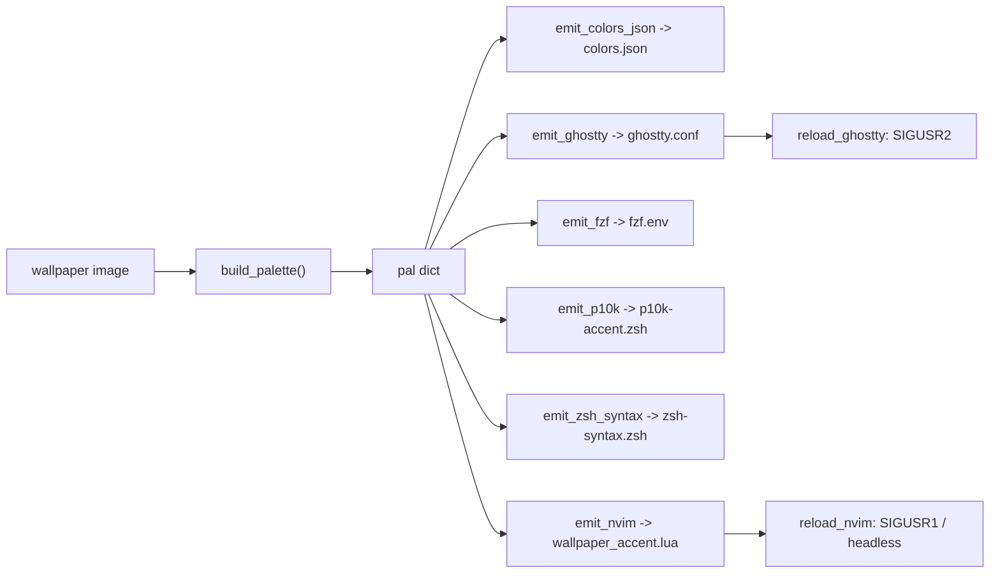

# wallpaper-accent — architecture & extension guide

Audience: **a future coding agent** (or me) asked to fix or extend this. User
how-to is in [`README.md`](./README.md); this is the engineering reference —
constraints, contracts, the "add a tool" recipe, and the environment traps that
bite if you skip them.

Repo: `~/.config/wallpaper-accent/` (standalone git repo, independent of the
`~/layers` dotfiles). The engine is a Python package under `src/wallpaper_accent/`
(run via `uv`); the repo-root `wallpaper-accent.py` is a thin PEP-723 shim the
launchd agent/shebang execute. Core → `colors.json` → per-tool **components**, so
adding or disabling a tool is a one-file change; `pyproject.toml` already declares
a `wallpaper-accent` console entry for growing into a CLI.

---

## TL;DR

- Extract accent from wallpaper → build palette → write `colors.json` → render
  per-app fragments → reload apps.
- Themes: ghostty, fzf, powerlevel10k, fast-syntax-highlighting, nvim (NvChad).
- Run: `~/.config/wallpaper-accent/wallpaper-accent.py --force`
- Inspect: `… --show` (swatches) / `… --print` (JSON) / `… --image X --print`.
- Triggered by launchd agent `com.kmurthi.wallpaper-accent` on login / wallpaper
  change / 15-min timer.

---

## Environment constraints (READ FIRST — load-bearing)

Corporate-managed macOS, arm64. Several "obvious" approaches are dead here:

| Constraint | Consequence |
|---|---|
| **Airlock** (app allowlisting) | Kills unsigned self-built binaries (matugen-via-cargo was killed). Don't add native binaries. `uv`, `python`, `nvim`, `ghostty`, `tmux`, `fzf` are allowlisted. |
| **Zscaler TLS MITM** | `uv` must run with `--system-certs` (macOS keychain has the Zscaler root). The plist also sets `SSL_CERT_FILE`. Shell env pre-sets `SSL_CERT_FILE`/`CARGO_HTTP_CAINFO`/`GIT_SSL_CAINFO` → `~/.config/certs/zscaler-ca.user.pem`. |
| **`pgrep` is broken** | Silently misses GUI apps. Process detection MUST use `ps -axo pid=,comm=` + basename (`_pids()`). Never reintroduce `pgrep`. |
| **macOS 26 wallpaper store** | Path read from `~/Library/Application Support/com.apple.wallpaper/Store/Index.plist` (nested bplist) — TCC-free, works under launchd. `osascript` is only a fallback. |
| **Dynamic/aerial/solid wallpapers** | No image file → `find_wallpaper()` returns None → `main()` logs and exits 0. |
| **No matugen / no Rust** | Palette engine is `materialyoucolor` via `uv`. Don't swap in matugen/pywal. |
| **Layers dotfiles** | `~/layers` (not a git repo): `00-core`, `10-generic`, `20-guidewire`, `30-local` (**machine-local**, holds `.zshrc.local`). `~/.config/ghostty` → symlink into `10-generic`. This repo is its OWN thing under `~/.config`, not a layer. |
| **Machine-local activation** | The engine is inert until integration points reference it: ghostty `config.local`, `.zshrc.local` source/atload lines, nvim `chadrc`/theme + autocmd, and the launchd agent. Keep new activation machine-local + guarded. |

Canonical invocation (shebang handles it):
`~/.config/wallpaper-accent/wallpaper-accent.py --force`

---

## Architecture



`main()`: `find_wallpaper()` → `is_dark_appearance()` → idempotency check
(`state.json` = image+mtime+dark, plus `colors.json` exists; `--force` overrides)
→ `build_palette()` → all `emit_*` → `reload_ghostty()`/`reload_nvim()` (unless
`--no-reload`). `--show`/`--print` short-circuit before the wallpaper is required
(they read `colors.json`).

---

## Package layout

```
~/.config/wallpaper-accent/            # standalone git repo
  wallpaper-accent.py                  # thin PEP-723 shim -> src (launchd runs this)
  pyproject.toml  .python-version      # deps (materialyoucolor) + console entry
  README.md  ARCHITECTURE.md
  src/wallpaper_accent/
    config.py       # paths, tint/scheme knobs, CATPPUCCIN, DEFAULT_COMPONENTS
    util.py         # log, atomic_write, rgb
    color.py        # dependency-free colour math (ΔE, contrast, hue geometry)
    procs.py        # ps-based pids() + signal_all()  (pgrep is unreliable here)
    wallpaper.py    # find_wallpaper(), is_dark_appearance()
    palette.py      # build_palette(image, dark) -> pal  + guards + collision_report
    show.py         # show_palette()  (--show swatches)
    cli.py          # main(): argparse + orchestration
    components/
      __init__.py   # Component dataclass, REGISTRY, enabled()
      ghostty.py fzf.py p10k.py zsh_syntax.py nvim.py   # emit() [+ reload()]
```

Generated output (NOT in the repo) under `~/.local/state/wallpaper-accent/`:
`colors.json` (palette, source of truth), `ghostty.conf`, `fzf.env`,
`p10k-accent.zsh`, `zsh-syntax.zsh`, `state.json`, `run.log`. Plus
`~/.config/nvim/lua/themes/wallpaper_accent.lua` (must be in nvim's runtimepath).

**Integration points (machine-local, edited once):**
- `~/.config/ghostty/config` → `?config.local` → `?…/wallpaper-accent/ghostty.conf`
- `~/layers/30-local/.zshrc.local`: guarded `source` of `fzf.env` and
  `p10k-accent.zsh`; F-Sy-H loaded with `atload'… source zsh-syntax.zsh'`
- `~/.config/nvim/lua/chadrc.lua` → `M.base46.theme = "wallpaper_accent"`
- `~/.config/nvim/lua/autocmds.lua` → `Signal`/`SIGUSR1` autocmd
- `~/Library/LaunchAgents/com.kmurthi.wallpaper-accent.plist`

---
## The palette contract

`build_palette()` returns `pal` (mirrored to `colors.json`):

```
pal = {
  "seed": "#RRGGBB", "dark": bool,
  "accent":  { primary, on_primary, primary_container, on_primary_container,
               secondary, on_secondary, secondary_container, on_secondary_container,
               tertiary, on_tertiary, tertiary_container, on_tertiary_container, error },
  "surface": { bg, black, fg, fg_variant, outline, selection, on_selection },
  "ramp": {tone:hex}, "greys": {tone:hex}, "grey_keys": [...],
  "base16": { base00..base0F },     # 00-07 tinted neutrals, 08-0F fixed hues
  "catppuccin": {...},
}
```
`colors.json` persists `source, seed, scheme, dark, accent, surface, base16`.

**Color model.** `materialyoucolor` scores the image → seed → a Material scheme
(default `SchemeVibrant`; `ACCENT_SCHEME`) → `MaterialDynamicColors` roles. The
scheme derives a **harmony**: primary/secondary/tertiary at rotated hues (how one
brand color becomes a varied-but-cohesive palette; `tonalspot` = monochromatic,
`vibrant` = spread). Backgrounds/greys are **not** Material's near-neutral
`surface` (chroma ~5, plain black) — `build_palette` builds them on the seed's own
**HCT** hue via `tinted(tone, chroma_cap)`. HCT: hue 0–360, chroma, tone 0–100.

**THE INVARIANT (do not break):** accent → surfaces, greys, cursor, selection,
accent-y UI, and it is **spread across primary/secondary/tertiary** so nothing is
monochromatic. **Semantic + syntax hues are fixed** (`CATPPUCCIN` / base16
`base08..base0F`), never the accent — keeps logs/diffs/`ls`/code legible. Every
emitter honors this (e.g. `emit_zsh_syntax` uses only base16, never the accent).

**Palette guards** (`palette.py`, all off `MIN_HUE_SEP`/`CHROMA_FLOOR`/… knobs;
pure colour math in `color.py`). Run inside `build_palette` to keep the invariant
usable on adversarial wallpapers:
1. **Robust seed** — `_select_seed` takes the most prominent quantized colour
   whose chroma ≥ `CHROMA_FLOOR` (skips near-greys → stable, non-washed accent).
2. **Chroma floor / greyscale fallback** — `_accent_seed` lifts a dull seed's
   chroma; if the hue is meaningless (chroma < `GREY_HUE_CHROMA`) it substitutes
   `FALLBACK_HUE` (210, in the wide teal→blue gap). Neutrals keep the real seed.
3. **Hue de-confliction** — spread schemes `repel_accent` (rotate each role group
   ≥ `MIN_HUE_SEP`° off every fixed syntax hue via `nearest_allowed_hue`);
   `tonalspot` (see `MONOCHROMATIC_SCHEMES`) instead `nudge_semantics` (move the
   colliding base08-0F hue off the accent, preserving the single-hue accent).
   This is what stops a blue wallpaper making the cursor impersonate syntax blue.
   The *only* sanctioned exception to "syntax hues are fixed" is that nudge.
4. **Contrast** — `enforce_contrast` lifts `fg`/`fg_variant` tone until they clear
   `FG_MIN_CONTRAST` over the (overridden) tinted `bg`.
5. **One selection colour** — `surface.selection`/`on_selection` (tertiary
   container) is the single source; **every** component reads it (no per-tool
   hardcoding). `collision_report(colors)` (ΔE-based, dependency-free) surfaces
   any residual collision in `--show`/`--print`.

**Knobs** (env): `GHOSTTY_ACCENT_SCHEME` (`vibrant`), `GHOSTTY_ACCENT_BG_TONE`
(14), `GHOSTTY_ACCENT_BG_CHROMA` (22), `GHOSTTY_ACCENT_BLACK_TONE` (22),
`GHOSTTY_ACCENT_BLACK_CHROMA` (18), `GHOSTTY_ACCENT_MIN_HUE_SEP` (20),
`GHOSTTY_ACCENT_CHROMA_FLOOR` (12), `GHOSTTY_ACCENT_FALLBACK_HUE` (210),
`GHOSTTY_ACCENT_FG_CONTRAST` (4.5). All palette-affecting knobs plus
`ENGINE_VERSION` are folded into the idempotency key (`config.tuning_signature()`)
so changing one re-themes without `--force`.

---

## Module map

| Module | Responsibility |
|---|---|
| `config.py` | paths, tint/scheme/guard knobs, `CATPPUCCIN`, `DEFAULT_COMPONENTS`, `tuning_signature()`, `ENGINE_VERSION` |
| `util.py` | `log`, `atomic_write`, `rgb` |
| `color.py` | dependency-free colour math: `delta_e`, `contrast_ratio`, `hue_distance`, `nearest_allowed_hue` (guards + `collision_report`) |
| `procs.py` | `pids(name)`, `signal_all(name, sig)` — **ps-based**, never pgrep |
| `wallpaper.py` | `find_wallpaper()` (Index.plist → osascript → None), `is_dark_appearance()` |
| `palette.py` | `build_palette(image, dark) -> pal` (**core**: seed, scheme, tinted neutrals, base16) + guards (`repel_accent`, `nudge_semantics`, `enforce_contrast`) + `collision_report` |
| `show.py` | `show_palette()` — `--show` swatches from colors.json |
| `cli.py` | `main()`: argparse, idempotency, `_write_colors_json`, orchestration |
| `components/__init__.py` | `Component(name, emit, reload)`, `REGISTRY`, `enabled()` |
| `components/<tool>.py` | `emit(pal)` writes the fragment; optional `reload()` applies it |

Every emitter takes the same `pal` dict and writes via `atomic_write`; signal
reloads go through `procs.signal_all(basename, sig)`.

Flags: `--force`, `--no-reload`, `--print` (JSON), `--show` (swatches),
`--image PATH`, `--dark`/`--light`.

**Enable/disable a tool:** edit `config.DEFAULT_COMPONENTS`, or set
`WALLPAPER_ACCENT_COMPONENTS="ghostty,fzf"` for a single run.

---
## Reload taxonomy (pick one per tool)

1. **Live via signal** — app re-reads on a signal. ghostty `SIGUSR2`, nvim
   `SIGUSR1` autocmd. Use `procs.pids()` / `procs.signal_all()`.
2. **Live via CLI** — a command repaints a running instance (`tmux source-file`,
   `kitty @ set-colors`). Shell out in the component's `reload()`.
3. **Re-read per invocation** — tool reads config each run (`delta`, `git`, `bat`
   with a fixed theme). Just write the fragment.
4. **New process only** — shell env/prompt (`fzf`, `p10k`, F-Sy-H). Wire a guarded
   `source`/`atload` in `.zshrc.local`; running shells update on next launch.

---

## Add a new tool — recipe

Worked example: **tmux** (live via CLI, class 2).

1. **Add a path** in `config.py`: `TMUX_CONF = STATE_DIR / "tmux-accent.conf"`.
2. **Create `components/tmux.py`** with `emit(pal)` (+ `reload()`), reading only
   from `pal` and honoring the invariant (accent on status/borders, not on
   message/semantic text):
   ```python
   import shutil, subprocess
   from .. import config
   from ..util import atomic_write, log

   def emit(pal):
       s, a = pal["surface"], pal["accent"]
       atomic_write(config.TMUX_CONF, f"""\
   set -g status-style "bg={s['bg']},fg={s['fg_variant']}"
   set -g pane-active-border-style "fg={a['primary']}"
   set -g mode-style "bg={a['tertiary_container']},fg={a['on_tertiary_container']}"
   """)

   def reload():
       tmux = shutil.which("tmux")
       if tmux and subprocess.run([tmux,"ls"],capture_output=True).returncode==0:
           subprocess.run([tmux,"source-file",str(config.TMUX_CONF)],capture_output=True)
           log("tmux: reloaded")
   ```
3. **Register** in `components/__init__.py`: import `tmux`, add
   `"tmux": Component("tmux", tmux.emit, tmux.reload)` to `REGISTRY`.
4. **Enable**: add `"tmux"` to `config.DEFAULT_COMPONENTS`.
5. **Integration** (machine-local, guarded) — in `~/.tmux.conf`, last so it wins:
   `if-shell "[ -r ~/.local/state/wallpaper-accent/tmux-accent.conf ]" "source-file ~/.local/state/wallpaper-accent/tmux-accent.conf"`
6. Test (cookbook below), then `--force`.

**Rules:** read only from `pal`; honor the invariant (spread accent across
primary/secondary/tertiary; keep semantic/syntax fixed); write via
`atomic_write`; process detection via `procs.pids("<basename>")`, never `pgrep`;
integration edits guarded so they no-op where the file is absent. Base16-consuming
tools: emit `pal["base16"]` in that tool's format.

---
## Verification cookbook

```bash
S=~/.config/wallpaper-accent/wallpaper-accent.py
$S --force && $S --show            # regenerate + eyeball swatches
cat ~/.local/state/wallpaper-accent/colors.json

# ghostty resolves; semantic hues unchanged
ghostty +show-config | grep -E '^(background|cursor-color|palette = [0-8]=)'

# nvim loads headless (no error) + reports Normal bg
nvim --headless -c "lua require('base46').load_all_highlights()" \
  -c "lua print(vim.api.nvim_get_hl(0,{name='Normal'}).bg)" -c qa

# nvim live reload: server + retheme + re-query (see git history for full test)
# zsh fragments source cleanly (F-Sy-H needs the array declared):
zsh -c 'source ~/.local/state/wallpaper-accent/fzf.env
        source ~/.local/state/wallpaper-accent/p10k-accent.zsh
        typeset -gA FAST_HIGHLIGHT_STYLES
        source ~/.local/state/wallpaper-accent/zsh-syntax.zsh
        echo $FZF_DEFAULT_OPTS; echo $FAST_HIGHLIGHT_STYLES[command]'

launchctl print gui/$(id -u)/com.kmurthi.wallpaper-accent | grep -iE 'state|runs|last exit'
```

Gotcha: `--no-reload` regenerates the nvim theme file but NOT the base46 disk
cache, so a fresh nvim reads a stale cache. Baseline with a real run first.

---

## launchd trigger model

Agent `com.kmurthi.wallpaper-accent` (LaunchAgent, Aqua): `RunAtLoad` (login),
`WatchPaths` (wallpaper Store dir + Index.plist), `StartInterval 900` (safety net
+ light/dark). Not a daemon — runs on demand and exits. `EnvironmentVariables`:
`HOME`, `PATH` (incl. `/opt/homebrew/bin`), `SSL_CERT_FILE`. Runs headless nvim to
refresh the base46 cache when no nvim is open (allowlisted, +~1s). Reload after
editing: `launchctl bootout gui/$(id -u)/com.kmurthi.wallpaper-accent` then
`bootstrap gui/$(id -u) <plist>`.

---

## NvChad specifics

- Custom theme `lua/themes/wallpaper_accent.lua`, selected by `M.base46.theme` in
  `chadrc.lua`. Format: `M.type`, `M.base_30` (UI named colors — match a builtin's
  key set, e.g. `onedark`), `M.base_16` (base00..base0F).
- Reload: `require("base46").load_all_highlights()` recompiles the disk cache
  (`vim.g.base46_cache`) AND applies live; clear
  `package.loaded["themes.wallpaper_accent"]` first (the SIGUSR1 autocmd does).
- **Never delete the base46 cache** — `init.lua` `dofile()`s it at startup.
- Missing theme file → `No such theme!`; the daemon regenerates every run.

---

## fast-syntax-highlighting specifics

- Styles live in `FAST_HIGHLIGHT_STYLES[<token>]='fg=#hex[,attr]'`; F-Sy-H reads
  the array at highlight time. Override AFTER it loads, else its theme wins — done
  via zinit `atload'… source zsh-syntax.zsh'` on the F-Sy-H plugin in
  `.zshrc.local`. Default theme makes every valid command **green** (green-on-green
  on a green wallpaper); `emit_zsh_syntax` remaps to a varied fixed palette.
- Token keys: see `themes/default.ini` in the plugin. `emit_zsh_syntax` uses only
  base16/`CATPPUCCIN` (never the accent).

---

## Design provenance

- **Own Python engine, not matugen/pywal**: no arm64 matugen binary; cargo build
  Airlock-killed; pywal stale. `materialyoucolor` runs on allowlisted `uv`.
- **Tinted-HCT backgrounds** vs Material's near-neutral surface → visible tint.
- **Semantic + syntax hues fixed** → legibility under any accent.
- **Accent harmony + role spread**: `TonalSpot` makes secondary≈primary (mono);
  default `Vibrant` spreads hues, and emitters assign primary/secondary/tertiary
  to distinct roles. Color-wheel harmony, automated.
- **base16 as the nvim/tool bridge**; **ps not pgrep; Index.plist not osascript;
  `--system-certs`** — all forced by this machine.
- **Own repo under `~/.config`**: the stack spans many tools, not just ghostty, so
  code+docs live centrally and can become a CLI.
